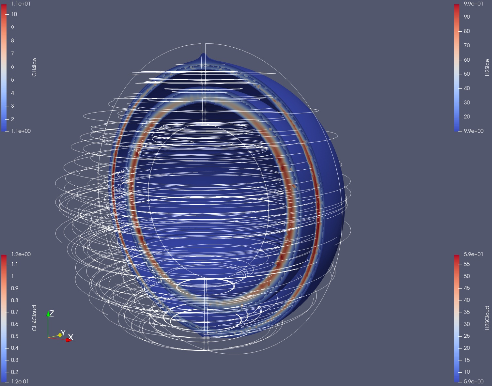
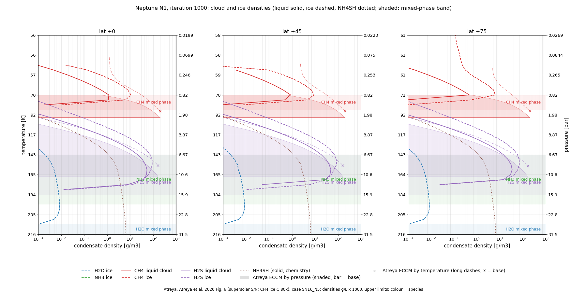

# ATNEPT

A 3-D circulation model of **Neptune's** atmosphere with methane and H₂S clouds, chemistry and turbulence -- one of four sibling models of the giant planets.

<p align="center"></p>

<p align="center"><sub>Cloud decks (coloured by density, cut open along a meridian) and wind stream lines (white) after the spin-up; more pictures and the comparison with observed cloud profiles under <i>Cloud profiles vs Atreya</i> below.</sub></p>

**The giant-planet family.** The four models share one numerical core (finite differences on a 41 × 181 × 361 spherical grid, 4th-order Runge-Kutta, a Poisson pressure solver, OpenMP) and 14 byte-identical shared headers (saturation adjustment, precipitation, moist convection, turbulence, radiation, boundary conditions, pressure solver, observed jets, cp(T) and more); each adds its own planet's set-up, chemistry and boundaries. A fix made in one is ported to the others.

| Planet | Model | Atmospheric shell | Cloud decks | What it looks at |
|---|---|---|---|---|
| Jupiter | [ATJUP](https://github.com/RogerGrundmann/ATJUP) | 140 km, ~13 bar to ~0.03 bar | H₂O, NH₄SH, NH₃ | the Great Red Spot: a wake behind a fixed obstacle, or a free vortex |
| Saturn | [ATSAT](https://github.com/RogerGrundmann/ATSAT) | 500 km, ~55 bar to 0.04-0.07 bar | H₂O, NH₄SH, NH₃ | moist convection and the super-rotating equatorial jet; chromophore tracer |
| Uranus | [ATURAN](https://github.com/RogerGrundmann/ATURAN) | 225 km, ~17 bar to 0.10-0.14 bar | CH₄, H₂S, NH₄SH, H₂O | the 98° tilt and the equator-to-pole temperature puzzle |
| Neptune | **ATNEPT** (this repo) | 200 km, ~32 bar to 0.03-0.05 bar | CH₄, H₂S, NH₄SH, H₂O | the fastest winds in the Solar System, driven by internal heat |

**Sister family:** the same ATOM numerics run the early Earth -- [ATHAD](https://github.com/RogerGrundmann/ATHAD) (steam atmosphere over the magma ocean) → [ATHAD_COND](https://github.com/RogerGrundmann/ATHAD_COND) (CO₂ over a hot sea) → [ATHAD_PERID](https://github.com/RogerGrundmann/ATHAD_PERID) (CO₂ after a peridotitic magma ocean).

Neptune atmospheric general circulation model based on the numerical framework of the
[ATOM climate model](https://github.com/atom-model/ATOM). Solves the 3-D Navier-Stokes equations in a spherical shell extending
from the deep H₂O / NH₃ / NH₄SH cloud decks up through the methane condensation layer
that defines Neptune's visible disk. Its precipitation scheme -- the COSMO three-category rain / snow / graupel scheme in the shared `Precipitation.h` -- comes from [ATOM_Precipitation](https://github.com/RogerGrundmann/ATOM_Precipitation), a development version of ATOM.

Despite being the most distant planet in the Solar System and receiving roughly
1/900th of Earth's solar flux, Neptune hosts the fastest sustained winds ever measured
on any planet — equatorial zonal jets reach 580 m/s, retrograde with respect to the
planetary rotation. The driver is internal: Neptune radiates about 2.6 times as much
energy as it absorbs from the Sun, and that interior heat budget is what powers the
storms (Voyager 2's "Great Dark Spot" of 1989, the bright methane "Scooter", and
successive dark spots tracked by Hubble) and the strongest atmospheric convection
known beyond Earth. Modelling this convection-driven circulation in a 3-D framework
is the principal motivation of ATNEPT.

For all relevant data concerning Neptune and its atmosphere the book *Planetary Sciences*
by Imke de Pater and Jack J. Lissauer was indispensable. ATNEPT also serves as the
reference implementation from which CH₄ chemistry was ported to the warmer planet
models (ATJUP, ATSAT).

---

## Physics & Numerics

- **Domain:** spherical shell, 41 × 181 × 361 grid points (r × θ × φ), ~2.7 million cells
- **Vertical extent:** 200 km atmospheric shell (5 km per radial step), 31.5 bar to 0.03-0.045 bar; 550 km before 2026-10-12
- **Dynamics:** finite-difference discretisation of the 3-D Navier-Stokes equations in spherical coordinates
- **Time integration:** 4th-order Runge-Kutta (inner loop) with a Poisson pressure solver (outer loop)
- **Parallelism:** OpenMP shared-memory threading
- **Thermodynamics:**
  - Temperature initialised as a parabolic pole-to-pole profile; reference temperature 72.5 K
  - Equatorial value 55.5 K, polar value 63.5 K — reflecting Neptune's observed warm-pole
    asymmetry (likely a signature of the same interior-driven convection that powers the jets)
  - Boussinesq buoyancy approximation
  - Clausius-Clapeyron / Sanchez-Lavega SVP formulation for saturation vapour pressures
  - Mixed-phase (liquid + ice) saturation adjustment with iterative convergence
- **Microphysics:** two-category ice scheme adapted from the COSMO weather-forecast model
- **Boundary conditions:** Voyager 2 IRIS temperature/pressure profiles; QuikSCAT and OSCAR
  observational datasets used as zonal-wind templates
- **Planetary constants:** g = 11.1 m/s², Ω = 1.08 × 10⁻⁴ rad/s (≈ 16.11 h sidereal day),
  reference wind speed 250 m/s, mean gas constant R = 3.181 J/(g·K)

---

## Chemical Species

| Species | Phases modelled | Role on Neptune |
|---------|-----------------|-----------------|
| CH₄ | vapour · cloud · ice | Defines the visible cloud deck near the tropopause; methane absorption gives Neptune its blue tint |
| H₂O | vapour · cloud water · cloud ice | Deep tropospheric cloud (~50 bar) |
| NH₃ | vapour · cloud · ice | Mid-troposphere reservoir; sequestered as NH₄SH |
| H₂S | vapour | Required for NH₄SH formation |
| NH₄SH | vapour | Heterogeneous reaction NH₃ + H₂S → NH₄SH at ~230 K |

Pole symmetry of the chemistry fields is checked at iteration 32 by comparing j = 1
against j = jm − 2 in ParaView; theta-derivative scalars are wrapped in `std::abs()`
inside `DiffMassFluxNept` so that pole-antisymmetric gradient components do not break
the symmetry of the resulting flux scalars.

### Cloud profiles vs Atreya



Neptune, arm N1 (the defaults of 2026-11-24, `ATNEPT_CP_H2` 1 + `_CP_GAS` 1, `satchk/cph2_2026-11-24`) at iteration 1000, against Atreya et al. 2020 Fig. 6 (case SN16_N5, S/N ~10x solar as in the set-up): H2S deck on Atreya's, CH4 cloud base ~1 bar (Atreya ~1.9). Condensate densities against temperature (left axis) and pressure (right axis) at three latitudes; liquid solid, ice dashed, NH4SH dotted; Atreya's ECCM shaded by pressure (bar = base) and as long dashes by temperature (x = base). Made with `python3 -I tools/cloudprofile_pv.py <zonal.vtk> --out <file.png>` (`--atreya <case>|none`, `--lat 0,45,75`); the set for all four giants is in `literature/cloudprofile_compare/` (outside the repo).


Neptune, arm N1 (the defaults of 2026-11-24, `satchk/cph2_2026-11-24`) at iteration 1000: CH4 ice / cloud and H2S ice / cloud on the sphere (`<Planet>_sphere_<n>.vts`, shells exaggerated to 1..2 radii), each species as the region above 10 % of its maximum, cut along the 90 / 270 deg meridians, one colour bar per species; white: Velocity stream lines. Made with `python3 -I literature/sphere_screens.py <sphere.vts> <Planet>` (outside the repo). The ice giants' sphere files carry no H2S / CH4 condensate (their writer drops those arrays), so these species are the panorama's wrapped onto the shells (`--pano`).

---

## Repository Layout

```
ATNEPT/
├── planet/          # core model (RHS, RK4, thermodynamics, chemistry, I/O)
├── lib/             # array types, config parser, FFT, utilities
├── cli/             # command-line driver (nept)
├── python/          # Cython bindings (pyatnept)
├── neptune/         # run directory (XML config, observational data, output)
│   ├── oscar/       # OSCAR ocean-current dataset (used as zonal-wind template)
│   └── windspeed/   # QuikSCAT surface wind data
├── tinyxml2/        # vendored XML library
├── param.py         # code-generation script (auto-generates parameter files)
└── Makefile
```

---

## Build

**Dependencies:** C++11 compiler with OpenMP support, Python 3, Cython, NumPy.

```bash
# Generate parameter files and build CLI + Python extension
make

# CLI binary only
make nept

# Python extension only
make python

# Clean
make clean
```

The `param.py` script auto-generates several `.inc` / `.pyx` files that parameterise the
model; it runs automatically as part of the build whenever `param.py` itself changes.

### Shared physics headers

Thirteen headers in `planet/` are **byte-identical across ATJUP, ATSAT, ATNEPT and ATURAN**:

```
ATPhys.h  BoundaryConditions.h  ConvectiveAdjustment.h  FluxLimiter.h  JetRef.h  ParaViewWriter.h
Precipitation.h  PressureSolver.h  ProcessDiag.h  Radiation.h  Reporting.h  SaturationAdjustment.h  Turbulence.h
```

There is no submodule and no symlink holding them together — Synology Drive has silently reverted
a working tree once, and a submodule costs friction on every clone. They are plain copies, and
`planet/SHARED.md5` is what makes a divergence loud:

```bash
make check-shared
```

Editing one means: edit it in one repo, copy it to the other three, regenerate its line in **all
four** manifests, and rebuild each.

**`make check-shared` cannot catch everything, and this is the part to read before trusting it.**
It verifies a repo against *its own* manifest, so two repos holding different copies of the same
header both report OK — a state that has already occurred once. The check that does catch it is a
diff between repos, which is why the checksum lines are kept sorted by filename:

```bash
diff ../ATJUP/planet/SHARED.md5 planet/SHARED.md5
```

---

## Optional modules

Every module and experiment is gated by an `ATNEPT_*` environment variable, grouped as: radiation (grey two-stream, shared `Radiation.h`), microphysics and turbulence, and numerics / experiment knobs.

The full knob tables (every environment variable with its default and effect, and the notes on them) are in [CLAUDE.md](CLAUDE.md).

---

## Diagnostics

What the model prints at the `checkpoint` cadence (min / max census, column profiles, budgets) and the print-only instruments that can be switched on.

The full text is in [CLAUDE.md](CLAUDE.md).

---

## Usage

### Command-line — note the TWO arguments

```bash
./cli/nept <path> <config file name>
./cli/nept . config_atnept.xml            # config in the current directory
```

A single combined path fails with `couldn't load config file inside cNeptuneModel`. This is the
reverse of ATOM's `cli/atm`, and the same convention ATSAT and ATURAN use.

```bash
OMP_NUM_THREADS=12 ./cli/nept . config_atnept.xml > run.log 2>&1
```

Runs in this repository's measurements are single-threaded (`OMP_NUM_THREADS=1`) so that results
are bit-reproducible and byte-comparisons between builds mean something.

**This model used to be non-reproducible above one thread, and that is fixed.** The site was
`PressureSolverNept.h`'s Poisson loop — Gauss-Seidel written in place, with
`#pragma omp parallel for collapse(2) schedule(dynamic, 4)` over the very two indices its stencil
reads across, so cell `(i,j,k)` was read by the thread owning `(i+1,j)` or `(i,j+1)` while its
owner was writing it. `schedule(dynamic)` meant the chunk assignment itself varied with timing, so
the same binary at the same thread count differed run to run. It is now serial; see the comment in
that file. Measured at nm=4:

| configuration | 16t run A vs B | 1t vs 16t |
|---|---|---|
| before, `ATNEPT_PRESS_SOLVER=0` (default) | differ, 1 of 7 files | differ, 6 of 7 files |
| after, `ATNEPT_PRESS_SOLVER=0` (default) | **bit-identical** | **bit-identical** |
| `ATNEPT_PRESS_SOLVER=1` (shared red-black) | **bit-identical** | **bit-identical** |

**Nothing was taken back to get this.** One thread ran `collapse(2)` in lexicographic order
already, so the serial loop reproduces the previous 1-thread answer bit-identically, with not one
differing log line — every single-threaded measurement in this file still stands. `computePressure`
was 0.003 s at 16 threads and is 0.03 s serial.

This defect was found in ATURAN and the same check was then run here. ATSAT and ATJUP never had it:
both deleted their per-planet solvers and bind straight to the shared red-black
`PressureSolver<Planet>`, which is byte-identical in all four repositories.

**The log is byte-comparable at any thread count too.** The saturation-adjustment block —
`i_sat`/`j_sat`/`k_sat`, `iter_prec_found`, and the `p_stat`, `T`, `saturation` and per-species
`humid/cloud/ice` values printed with them — was for a while the only thing that still varied.
It is filled under `#pragma omp critical` in `SaturationAdjustmentNept.cpp` and used to record
whichever cell reached the section *last*, so the winner followed thread arrival order. That was
never a race — the section is properly synchronised and writes reporting variables only, and every
output file was bit-identical across it — but it made logs from different thread counts impossible
to diff.

The winner is now chosen by **position** instead: the loop nest is `k`, then `j`, then `i`, so
serial traversal visits `key = (k·jm + j)·im + i` in increasing order and "the last cell found
wins" is exactly "the largest key wins". Taking the maximum reproduces the single-threaded answer
at any thread count. **Which cell is reported did not change** — at 1 thread the log is unchanged
line for line; at 16 threads it now matches it, and two 16-thread runs match each other.

### Python

```python
import sys
sys.path.insert(0, "neptune")
import pyatnept

model = pyatnept.NeptuneModel()
model.load_config("neptune/config_atnept.xml")
model.run()
```

Output is written as VTK / VTS files for visualisation in ParaView (panorama, sphere,
radial, zonal, and longitudinal cross-sections).

---

## Known limitations

The photosphere is too warm (mostly redistribution, not heating), the thermal-massflux term is an instrument rather than a fix, old output carries a wrong static pressure profile, radiation is the one module that does not feed back by default, the corrected metric radius, the Jupiter-calibrated grey opacity, and `ATNEPT_RAD_COUPLING` as the anchor (items 1-8, measured from 2026-10-12 on).

The full text is in [CLAUDE.md](CLAUDE.md).

---

## Author

Roger Grundmann — roger.grundmann@web.de
